# AI 辅助的 DIRAC 部署 与运维 · IHEP

#### dci-agent · 分阶段自主 · MCP 与技能

 

**Xiao Han** 代表 IHEP DCI 组 · <a href="mailto:hanx@ihep.ac.cn">hanx@ihep.ac.cn</a>

 

**第 12 届 DIRAC(X) 用户研讨会** · 2026 · *IHEP，北京*

<a href="https://indico.cern.ch/event/1588323" class="ns-c-iconlink"><mdi-link-variant /> Workshop Indico</a>

<!--
Timing: 0:30

Good morning. I am Xiao Han, from the IHEP DCI Group. AI models keep getting stronger — they reason better, and they understand systems like ours better every year. We decided to put that to work: at IHEP we run an operational agent, dci-agent, which helps us deploy and operate DIRAC and the middleware chain around it. This talk has two halves: first the operations story — what dci-agent is and does, including a DIRAC v9 deployment it carried out in the test environment; then the AI infrastructure underneath — the MCP services and the skills that make it useful and safe.
-->
---
layout: default
---

# 更强的 AI 正在参与 DCI 运维

  

## 为什么是现在

- 模型更<strong>强大</strong> — 对配置、日志和代码的推理更好
- 能<strong>跨系统推理</strong> — DIRAC、FTS 与网格中间件
- 工具生态成熟 — <strong>MCP</strong>、agent 框架、技能库

在 IHEP，我们部署了 <strong>dci-agent</strong>，把跨系统的证据引入日常运维。

  

  

## 目录

- <strong>第一部分 · dci-agent</strong> — 用它运维 DIRAC 与周边服务
- <strong>第二部分 · IHEP AI infrastructure</strong> — 背后的平台：MCP 与技能

<!--
Timing: 0:50

Why this talk now? Models reason better over configs, logs and code, and MCP and skills make that reasoning useful. We deployed dci-agent to bring evidence from across IHEP DCI into everyday operations: see the chain, answer and report, help deploy, and keep actions inside an explicit boundary. First I will show the operations; then I will show the infrastructure behind them.
-->
---
layout: section
---

# 1 · 运维：dci-agent

<!--
Timing: 0:10

Part one: dci-agent — how an AI operations assistant should grow, what it is, and what it has already done.
-->
---
layout: default
---

# dci-agent 如何成长：四个受控阶段

类似自动驾驶的分级，我们把 AI 助手分为四个不同的层级。

  

    <h2>1 · 只读分析</h2>
    
完全只读：建议、告警、初步诊断 — 给出依据，人来决策。

  

  

    <h2>2 · 协助操作</h2>
    
执行无害操作 — 重复、可逆、困扰管理员的日常工作。

  

  

    <h2>3 · 经批准执行</h2>
    
关键操作先准备，必须在管理员同意后才执行。

  

  

    <h2>4 · 自动驾驶</h2>
    
全面自动化 — 未来目标，不是今天的现状。

  

学习闭环：Hermes 可以把对话和操作沉淀为<strong>经审核的技能</strong>。更强的模型和积累的知识让更高自主成为可能 — <strong>不是自动获得</strong>。

<!--
Timing: 1:20

Like the autonomous-driving levels, we classify AI assistants into four distinct levels. The stages: read-only analysis and alarms; harmless, reversible actions; critical actions with administrator approval; and ultimately full automation. The last stage is a goal, not today's reality. Hermes can summarize conversations and operations into skills for human review. Better models and accumulated knowledge help us move upward, but each stage also needs stronger controls and evidence — learning alone never grants authority. With that framing, here is the estate the assistant works on.
-->
---
layout: default
---

# DCI 运维横跨多个系统

  

  
<small>生产环境</small><strong>DIRAC v8.0.58（JUNO）</strong>5 台服务器上 90+ 组件；4 个 SiteDirector 实例（JUNO、CEPC、BES、JUNOCloud）。

  
<small>中间件链</small><strong>FTS3 · grid-data · IHEPDIRAC · T1 CE</strong>传输、存储与站点服务 — 各自有配置、日志与源码。

  
<small>准备中</small><strong>v9 迁移基线</strong>测试主机上 agent 已基本完成 v9.0.26 部署。

  

  

日常工作分四条线：

- **部署** — 版本升级、组件安装、配置变更
- **监控** — 指标、可用性探测、仪表盘
- **诊断** — 组件日志、传输链路、跨系统追踪
- **沉淀** — 运行手册、安装笔记、下一次值班需要的知识

故障的现象和根源往往在<strong>不同系统</strong>上 — 这正是只有一个只读视图的 agent 发挥作用的地方。

  

<!--
Timing: 0:50

Context. In production we run DIRAC v8.0.58 for JUNO — ninety-plus components, four SiteDirectors — inside a middleware chain of FTS3, grid-data, IHEPDIRAC and the T1 computing element. Daily work is four streams: deploy, watch, diagnose, record. And the pain point: symptoms and causes live on different systems. That is the gap dci-agent fills. Next: the architecture that gives one assistant this single read-only view.
-->
---
layout: default
---

# dci-agent 的架构

  
<strong>只读 NFS</strong>配置 · 日志 · 源码 · 凭据已脱敏

  

    DIRACIHEPDIRACFTS3grid-dataihep-T1-ce
  

  
只读证据<i aria-hidden="true"></i>

  

    
<small>MCP</small><strong>IHEP MCP</strong>监控 · 服务控制

    <b aria-hidden="true">→</b>
    
<small>基于 Hermes</small><strong>dci-agent</strong>关联 · 分析 · 报告

    <b aria-hidden="true">→</b>
    
<small>输出</small><strong>状态报告</strong>检查与发现

  

  

    
<i aria-hidden="true"></i><strong>飞书 · Mattermost · 企业微信 · WebUI</strong>管理员对话

    
<strong>cronjob</strong> → 定时检查

  

证据挂载是<strong>只读</strong>的。任何运维写入都走单独的、受限的 MCP 操作路径。

<!--
Timing: 1:25

The architecture. Read-only NFS mounts bring sanitized configurations, logs and source from DIRAC, IHEPDIRAC, FTS3, grid-data and ihep-T1-ce. The IHEP MCP gateway provides monitoring queries on the read side and scoped server-control functions on the write side. Administrators reach the Hermes-based dci-agent through Feishu, Mattermost, WeCom or WebUI; a cronjob triggers scheduled checks, and the agent produces status reports. Notice that this diagram is the evidence path: operational writes do not flow back through the NFS mounts. They use the separate, scoped MCP functions shown later.
-->
---
layout: default
---

# dci-agent 的 Web UI

  

## 视频演示内容

- **仪表盘** — 服务与系统状态总览
- **状态检查** — 对整条链路执行检查
- **状态分析** — 深入分析故障与异常
- **周期任务** — 设置定时检查
- **对话窗口** — 用自然语言提问
- **日志查询** — 查询组件日志

  

  <video :src="'./dci-agent-demo-trimmed.mp4'" autoplay loop muted playsinline controls preload="metadata" aria-label="dci-agent Web UI 屏幕录制"></video>
  
<mdi-monitor-screenshot /> dci-agent Web UI · 屏幕录制（静音）

  

<!--
Timing: 1:05

A quick walkthrough of the web UI. The dashboard summarizes services and system status; status checks run across the chain; the analysis view drills into failures and anomalies; periodic tasks schedule the same checks; the chat window takes questions in natural language; and component logs are searchable from the same UI. The same agent is reachable from Feishu, Mattermost, WeCom or this web UI.
-->
---
layout: default
---

# dci-agent 的两个实际案例

  

## 案例 1 · 测试环境部署

- 仅在<strong>测试环境获得操作权限</strong>
- 安装 <strong>DIRAC v9.0.26</strong>，基本完成部署
- 速度来自理解：按需对整个 DCI 栈做<strong>配置对比</strong>和<strong>日志检查</strong>
- 每一步都记录为运行手册式笔记

生产保持 <strong>v8.0.58</strong> — 未受影响。

  

  

## 案例 2 · JUNO Re-Production

- Re-Production 阶段组件<strong>卡死</strong>
- dci-agent <strong>快速排查</strong>
- 定位原因：<strong>MQ 服务不可用会导致组件同步卡死</strong>

  
<mdi-check-circle-outline /><strong>根因已定位</strong> MQ 服务不可用 → 组件同步卡死

  

<!--
Timing: 1:20

Two quick cases. In the isolated test environment we gave the agent operation permission. It installed DIRAC v9.0.26 and largely completed the deployment; production on v8.0.58 was not touched. In the second case, components froze during the JUNO re-production phase; the agent troubleshot it quickly and pinpointed that an unavailable MQ service stalls component sync. Next, the infrastructure that defines which actions an agent may take.
-->
---
layout: section
---

# 2 · IHEP AI infrastructure：MCP 与技能

<!--
Timing: 0:10

Part two: the IHEP AI infrastructure — first the platform itself, then the MCP services on the read and write sides, and the skills that make the agent useful to administrators and users alike.
-->
---
layout: default
---

# IHEP AI 平台

  
<strong>1</strong><h2>自部署模型</h2>
部署在自有基础设施上的模型服务。

  
<strong>2</strong><h2>中转外部模型</h2>
通过平台中转接入的外部模型，统一入口管理。

  
<strong>3</strong><h2>经费计费</h2>
用量直接计入用户经费 — 快速开通，便捷使用。

一套平台同时提供自部署与外部模型，计费跟着用户经费走。

<!--
Timing: 0:35

Before the MCP details, the platform underneath. The IHEP AI platform serves models we deploy ourselves, and it relays external models through one entry. Billing is tied to the user's project funds, so a new user can start quickly without a separate arrangement. dci-agent runs on this platform.
-->
---
layout: default
---

# MCP 函数定义了 agent 能执行什么

  
<small>请求</small><strong>dci-agent</strong>运维意图
<b aria-hidden="true">→</b>
  
<small>身份</small><strong>受限 token</strong>仅允许的操作
<b aria-hidden="true">→</b>
  
<small>边界</small><strong>MCP 函数</strong>预定义参数
<b aria-hidden="true">→</b>
  
<small>目标</small><strong>DIRAC / FTS</strong>具体服务

例：重启选定的 DIRAC 组件例：重启 FTS 服务

  
<mdi-key-outline /><strong>受限 token</strong> — agent 用专用 token 认证，其 scope 明确列出可执行的内容；其余均不可达。

  
<mdi-cube-outline /><strong>操作是代码，不是提示词</strong> — "重启组件 X" 是 MCP 服务内的内部函数；agent 无法拼出任意的 shell 命令。

  
<mdi-book-open-variant-outline /><strong>技能引导决策</strong> — 技能描述何时调用函数；真正能否执行由 token 范围和 MCP 实现强制。

<!--
Timing: 1:20

The write side is separate. A dedicated token limits which MCP functions are callable; the service exposes predefined operations such as restarting a selected DIRAC component or FTS service rather than an arbitrary shell interface. Skills advise the model when a call is appropriate, but they are not an authorization gate: the token and MCP implementation enforce that boundary. For a critical operation we would add explicit administrator approval; that is the next stage, not something to infer from today's function catalog.
-->
---
layout: default
---

# MCP 网关架构

```mermaid {scale: 0.8}
graph LR
    A[Client] -->|MCP JSON-RPC| B[IHEP MCP Gateway]
    B -->|verify-key| C[Auth Service]
    C -->|LDAP| D[(IHEP LDAP)]
    C -->|SQL| E[(PostgreSQL)]
    B -->|tool call| F[HTCondor<br/>SLURM]
    C -->|Web UI| G[React SPA]
    G -->|REST API| C
    style C fill:#313244,stroke:#89b4fa
    style G fill:#313244,stroke:#94e2d5
```

客户端通过标准 <strong>MCP JSON-RPC</strong> 与网关通信；每次调用先经验证，才会执行工具。

<strong>分层解耦</strong> — 身份来自 IHEP LDAP，状态存于 PostgreSQL，后端工具挂在 FastMCP 之后；每次调用都验证并留痕。

<!--
Timing: 0:40

One slide on how the gateway itself is built. Clients — dci-agent, scripts, other agents — speak MCP JSON-RPC to the gateway. Before any tool executes, the call is verified: the auth service checks the key against LDAP identity and PostgreSQL state and returns the allowed scopes. Verified calls are dispatched to FastMCP, which triggers the backend tools — HTCondor, SLURM and the rest. The same auth service serves the React web console. Layered and decoupled: each piece can be inspected and replaced on its own.
-->
---
layout: default
---

# 网关控制台让白名单看得见

  <figure class="gateway-shot">
    
    <figcaption><mdi-login-variant /> LDAP 登录 — 唯一入口</figcaption>
  </figure>
  <figure class="gateway-shot">
    
    <figcaption><mdi-cube-outline /> 78 个工具 — 逐工具 scope 与风险等级</figcaption>
  </figure>
  <figure class="gateway-shot">
    
    <figcaption><mdi-shield-key-outline /> 11 个 scope — 角色映射</figcaption>
  </figure>
  <figure class="gateway-shot">
    
    <figcaption><mdi-file-document-outline /> 认证事件 — 全部审计</figcaption>
  </figure>

权限是<strong>数据，不是提示词</strong> — 逐工具 scope 与风险等级；危险操作需 <strong>admin 角色</strong>；认证事件全部<strong>审计</strong>。

<!--
Timing: 0:40

The gateway console, in practice. Login is LDAP-based — the same identity as the cluster. The tool registry holds 78 tools; each protected tool names its required scopes and a risk level, and dangerous operations additionally require the admin role. Scopes map to roles in one place, and every login or API-key verification lands in the audit log. The whitelist is not a slide — it is configuration an administrator can inspect.
-->
---
layout: default
---

# 经审核的技能让经验可复用

  
<small>01 · 做</small><strong>对话 或操作</strong>
<b aria-hidden="true">→</b>
  
<small>02 · 提炼</small><strong>agent 总结 有效做法</strong>
<b aria-hidden="true">→</b>
  
<small>03 · 审核</small><strong>人工检查 成文内容</strong>
<b aria-hidden="true">→</b>
  
<small>04 · 复用</small><strong>发布为 技能</strong>

  
<strong>面向运维</strong> DIRAC 与作业操作技能、每仓库 agent 指南、v9 升级笔记 — 每次修复都成为下一次会话的文档化起点。

  
<strong>面向用户 — 已可用</strong> JUNO DIRAC 基础打包为技能：用户可以让 agent <strong>提交作业</strong>、<strong>查询文件</strong>，不用记住每条命令。

下一次会话直接查阅经审核的技能；agent 不必重新摸索同一流程。

<!--
Timing: 1:10

Skills are how the system compounds. After a conversation or an operation, the agent summarizes what worked; a human reviews the write-up; approved summaries are published as skills. Two audiences benefit. For operations: DIRAC and job-operations skills, repository guides, the v9 upgrade notes — every fix becomes a documented step. And for users, this is already live: the JUNO DIRAC basics are packaged as skills, so a user can ask the agent to submit a job or query files without remembering every DIRAC command by heart. The same loop — do, summarize, review, publish — powers both.
-->
---
layout: default
---

# 五条边界控制运维风险

  
<mdi-check-circle-outline /><strong>NFS 证据面只读。</strong>配置、日志、源码挂载时没有写路径；操作使用单独的 MCP 函数。

  
<mdi-check-circle-outline /><strong>凭据在模型之前脱敏。</strong>token、密钥、密码被屏蔽；源码与日志仍是不可信输入。

  
<mdi-check-circle-outline /><strong>操作是受限 token 后面的白名单函数。</strong>agent 调用预定义操作 — 无法拼出任意命令。

  
<mdi-check-circle-outline /><strong>技能指导何时调用操作。</strong>授权由 MCP 范围和函数实现强制，而不是技能文本。

  
<mdi-check-circle-outline /><strong>知识写成供查阅的形式。</strong>笔记和技能是工作流的一部分 — 是下一次会话或用户首先读的东西。

<!--
Timing: 1:00

Five boundaries hold the story together: read-only evidence mounts, credential sanitization, scoped tokens, predefined functions, and reviewed procedural knowledge. The skill tells the agent when to consider an action, but authorization lives in the MCP service; approval for dangerous actions remains a separate requirement. These are distinct controls, not five interchangeable promises.
-->
---
layout: default
---

# 路线图：用证据赢得自主

  

## 横向 — 拓宽视野

  
<mdi-arrow-right-circle-outline /><strong>更多数据源，同一契约</strong> 更多中间件挂载；对全部数据源做定时分析

  
<mdi-arrow-right-circle-outline /><strong>日志早期预警</strong> 集中日志中的错误模式与日志率异常

  
<mdi-arrow-right-circle-outline /><strong>运行手册 RAG</strong> 在自建基础设施上用自然语言查询积累的笔记

  

  

## 纵向 — 扩大白名单

  
<mdi-arrow-right-circle-outline /><strong>更多 MCP 函数</strong> 每个新操作都以经审核的内部函数加独立范围进入

  
<mdi-arrow-right-circle-outline /><strong>更多面向用户的技能</strong> 超越 JUNO 基础的作业提交与文件查询

  
<mdi-arrow-right-circle-outline /><strong>审计 + 审批流</strong> 每个操作持久化；第三阶段关键操作需明确同意

  

每个新操作都是一次认真的<strong>代码评审</strong>，不是改提示词。自主靠证据赢得，不是靠自信。

<!--
Timing: 1:00

The roadmap. Horizontal: widen the view — more middleware mounts, log early warning, retrieval over our own runbooks. Vertical: widen the whitelist — each new operation enters as a reviewed internal function with its own scope; more user-facing skills beyond the JUNO basics; and audit plus approval flows, which is how stage three — critical operations with explicit consent — gets earned. Each new action is a deliberate code review, not a prompt tweak. Autonomy is earned by evidence, not by confidence.
-->
---
layout: default
---

# 一个视图、有界操作、可复用知识

  
<strong>1</strong><h2>一个视图</h2>
dci-agent 看到整条链 — 配置、日志、源码、监控 — 只读且脱敏，聊天或定时可用。

  
<strong>2</strong><h2>分阶段自主</h2>
从只读分析到经批准的操作：每一步都需要更强的控制与证据。

  
<strong>3</strong><h2>复利效应</h2>
技能同时服务管理员与用户 — 每次对话和修复都让下一个任务更容易。

今天不是自动驾驶。 
是给操作者和用户<strong>更长的手臂</strong> — 有一条靠证据赢得的自主之路。

<!--
Timing: 0:50

Three takeaways. One evidence view across the DCI, available in chat and on a schedule. Bounded actions, with stronger controls before advancing to more autonomy. And reviewed skills serving both administrators and users. Today this is not an autopilot; it gives operators and users a longer reach and a deliberate path toward more automation. Thank you.
-->
---
layout: cover
loop: true
title: Questions
---

# 谢谢！欢迎提问

**Xiao Han · IHEP, CC** 
IHEP DCI 组

<a href="https://indico.cern.ch/event/1588323" class="ns-c-iconlink"><mdi-link-variant /> Workshop Indico</a>

<!--
Timing: 0:15

That is the end of my talk. Thank you — I am happy to take questions.
-->
