```mermaid {scale: 0.8}
graph LR
    A[Client] -->|MCP JSON-RPC| B[IHEP MCP Gateway]
    B -->|verify-key| C[Auth Service]
    C -->|LDAP| D[(IHEP LDAP)]
    C -->|SQL| E[(PostgreSQL)]
    B -->|tool call| F[HTCondor<br/>SLURM]
    C -->|Web UI| G[React SPA]
    G -->|REST API| C
    style C fill:#313244,stroke:#89b4fa
    style G fill:#313244,stroke:#94e2d5
```

# AI-Assisted DIRAC Deployment and Operations at IHEP

#### dci-agent, staged autonomy, MCP and skills

 

**Xiao Han** on behalf of the IHEP DCI Group · <a href="mailto:hanx@ihep.ac.cn">hanx@ihep.ac.cn</a>

 

**The 12th DIRAC(X) Users' Workshop** · 2026 · *IHEP, Beijing*

<a href="https://indico.cern.ch/event/1588323" class="ns-c-iconlink"><mdi-link-variant /> Workshop Indico</a>

<!--
Timing: 0:30

Good morning. I am Xiao Han, from the IHEP DCI Group. AI models keep getting stronger — they reason better, and they understand systems like ours better every year. We decided to put that to work: at IHEP we run an operational agent, dci-agent, which helps us deploy and operate DIRAC and the middleware chain around it. This talk has two halves: first the operations story — what dci-agent is and does, including a DIRAC v9 deployment it carried out in the test environment; then the AI infrastructure underneath — the MCP services and the skills that make it useful and safe.
-->
---
layout: default
---

# A stronger AI now helps operate the DCI

  

## Why now

- Models are <strong>stronger</strong> — better reasoning over configs, logs, and code
- They can <strong>reason across our stack</strong> — DIRAC, FTS, and grid middleware
- Tool ecosystems matured — <strong>MCP</strong>, agent frameworks, skill libraries

At IHEP we deployed <strong>dci-agent</strong> to bring cross-system evidence into everyday operations.

  

  

## Contents

- <strong>Part 1 · dci-agent</strong> — how we operate DIRAC and services with it
- <strong>Part 2 · IHEP AI infrastructure</strong> — the AI platform and MCP behind it

<!--
Timing: 0:50

Why this talk now? Models reason better over configs, logs and code, and MCP and skills make that reasoning useful. We deployed dci-agent to bring evidence from across IHEP DCI into everyday operations: see the chain, answer and report, help deploy, and keep actions inside an explicit boundary. First I will show the operations; then I will show the infrastructure behind them.
-->
---
layout: section
---

# 1 · Operate: the dci-agent

<!--
Timing: 0:10

Part one: dci-agent — how an AI operations assistant should grow, what it is, and what it has already done.
-->
---
layout: default
---

# How dci-agent grows: four controlled stages

Similar to autonomous driving tiers, we classify AI assistants into four distinct levels.

  

    <h2>1 · Analyzes</h2>
    
Completely read-only: advice, alarms, first-pass diagnosis — evidence cited, humans decide.

  

  

    <h2>2 · Assists</h2>
    
Executes harmless operations — the routine, reversible work that burdens administrators.

  

  

    <h2>3 · Acts, approved</h2>
    
Critical operations prepared and executed only with the administrator's consent.

  

  

    <h2>4 · Autopilots</h2>
    
Full automation across operations — a future goal, not today's claim.

  

The learning loop: Hermes can distill conversations and operations into <strong>reviewed skills</strong>. Greater model capability and accumulated knowledge make higher autonomy possible — <strong>not automatic</strong>.

<!--
Timing: 1:20

Like the autonomous-driving levels, we classify AI assistants into four distinct levels. The stages: read-only analysis and alarms; harmless, reversible actions; critical actions with administrator approval; and ultimately full automation. The last stage is a goal, not today's reality. Hermes can summarize conversations and operations into skills for human review. Better models and accumulated knowledge help us move upward, but each stage also needs stronger controls and evidence — learning alone never grants authority. With that framing, here is the estate the assistant works on.
-->
---
layout: default
---

# DCI operations cross multiple systems

  

  
<small>PRODUCTION</small><strong>DIRAC v8.0.58 for JUNO</strong>90+ components on 5 servers; 4 SiteDirector instances (JUNO, CEPC, BES, JUNOCloud).

  
<small>MIDDLEWARE CHAIN</small><strong>FTS3 · grid-data · IHEPDIRAC · T1 CE</strong>Transfers, storage and site services — each with its own configs, logs, and source.

  
<small>IN PREPARATION</small><strong>v9 migration baseline</strong>A test host where the agent largely completed a v9.0.26 deployment.

  

  

The daily work is four streams:

- **Deploy** — version upgrades, component installs, config changes
- **Watch** — metrics, availability probes, dashboards
- **Diagnose** — component logs, transfer chains, cross-system traces
- **Record** — runbooks, install notes, the knowledge the next shift needs

A fault's symptom and its cause often live on <strong>different systems</strong> — exactly where an agent with one read-only view helps.

  

<!--
Timing: 0:50

Context. In production we run DIRAC v8.0.58 for JUNO — ninety-plus components, four SiteDirectors — inside a middleware chain of FTS3, grid-data, IHEPDIRAC and the T1 computing element. Daily work is four streams: deploy, watch, diagnose, record. And the pain point: symptoms and causes live on different systems. That is the gap dci-agent fills. Next: the architecture that gives one assistant this single read-only view.
-->
---
layout: default
---

# The dci-agent architecture

  
<strong>READ-ONLY NFS</strong>configs · logs · source code · credentials sanitized

  

    DIRACIHEPDIRACFTS3grid-dataihep-T1-ce
  

  
read-only evidence<i aria-hidden="true"></i>

  

    
<small>MCP</small><strong>IHEP MCP</strong>monitoring · server control

    <b aria-hidden="true">→</b>
    
<small>HERMES-BASED</small><strong>dci-agent</strong>correlate · analyze · report

    <b aria-hidden="true">→</b>
    
<small>OUTPUT</small><strong>Status reports</strong>checks &amp; findings

  

  

    
<i aria-hidden="true"></i><strong>Feishu · Mattermost · WeCom · WebUI</strong>administrator chat

    
<strong>cronjob</strong> → scheduled checks

  

The evidence mounts are <strong>read-only</strong>. Any operational write uses a separate, scoped MCP action path.

<!--
Timing: 1:25

The architecture. Read-only NFS mounts bring sanitized configurations, logs and source from DIRAC, IHEPDIRAC, FTS3, grid-data and ihep-T1-ce. The IHEP MCP gateway provides monitoring queries on the read side and scoped server-control functions on the write side. Administrators reach the Hermes-based dci-agent through Feishu, Mattermost, WeCom or WebUI; a cronjob triggers scheduled checks, and the agent produces status reports. Notice that this diagram is the evidence path: operational writes do not flow back through the NFS mounts. They use the separate, scoped MCP functions shown later.
-->
---
layout: default
---

# The dci-agent web UI

  

## What the recording shows

- **Dashboard** — services and system status at a glance
- **Status checks** — run checks across the chain
- **Status analysis** — drill into failures and anomalies
- **Periodic tasks** — schedule recurring checks
- **Chat** — ask questions in natural language
- **Log query** — search component logs

  

  <video :src="'./dci-agent-demo-trimmed.mp4'" autoplay loop muted playsinline controls preload="metadata" aria-label="Screen recording of the dci-agent web UI"></video>
  
<mdi-monitor-screenshot /> dci-agent web UI · screen recording (muted)

  

<!--
Timing: 1:05

A quick walkthrough of the web UI. The dashboard summarizes services and system status; status checks run across the chain; the analysis view drills into failures and anomalies; periodic tasks schedule the same checks; the chat window takes questions in natural language; and component logs are searchable from the same UI. The same agent is reachable from Feishu, Mattermost, WeCom or this web UI.
-->
---
layout: default
---

# Two cases where dci-agent helped

  

## Case 1 · Test deployment

- Given <strong>operation permission in the test environment only</strong>
- Installed <strong>DIRAC v9.0.26</strong> and basically completed the deployment
- The speed came from understanding: <strong>config comparison</strong> and <strong>log inspection</strong> across the DCI stack, on demand
- Every step recorded as runbook-style notes

Production stays on <strong>v8.0.58</strong> — untouched.

  

  

## Case 2 · JUNO re-production

- Components <strong>stuck</strong> during the JUNO re-production phase
- dci-agent <strong>troubleshot it quickly</strong>
- Found the cause: an <strong>unavailable MQ service stalls component sync</strong>

  
<mdi-check-circle-outline /><strong>Root cause identified</strong> MQ service down → component sync hangs

  

<!--
Timing: 1:20

Two quick cases. In the isolated test environment we gave the agent operation permission. It installed DIRAC v9.0.26 and largely completed the deployment; production on v8.0.58 was not touched. In the second case, components froze during the JUNO re-production phase; the agent troubleshot it quickly and pinpointed that an unavailable MQ service stalls component sync. Next, the infrastructure that defines which actions an agent may take.
-->
---
layout: section
---

# 2 · IHEP AI infrastructure: platform and MCP

<!--
Timing: 0:10

Part two: the IHEP AI infrastructure — the AI platform that provides LLM APIs, and, at the same level, the MCP services on the read and write sides.
-->
---
layout: default
---

# The IHEP AI platform

It serves <strong>LLM APIs</strong> to our services — dci-agent runs on them.

  
<strong>1</strong><h2>Self-deployed models</h2>
Models deployed and served on our own infrastructure.

  
<strong>2</strong><h2>Relayed external models</h2>
External models reachable through the platform's relay — one entry to manage.

  
<strong>3</strong><h2>Billing via user funds</h2>
Usage is charged directly to the user's project funds — quick to start, easy to use.

One <strong>LLM API</strong> entry for in-house and external models — and the bill follows the user's funds.

<!--
Timing: 0:35

Before the MCP details, the platform underneath. The IHEP AI platform serves models we deploy ourselves, and it relays external models through one entry. Billing is tied to the user's project funds, so a new user can start quickly without a separate arrangement. dci-agent runs on this platform.
-->
---
layout: default
---

# MCP functions define what the agent can execute

  
<small>REQUEST</small><strong>dci-agent</strong>operational intent
<b aria-hidden="true">→</b>
  
<small>IDENTITY</small><strong>scoped token</strong>allowed actions only
<b aria-hidden="true">→</b>
  
<small>BOUNDARY</small><strong>MCP function</strong>predefined parameters
<b aria-hidden="true">→</b>
  
<small>TARGET</small><strong>DIRAC / FTS</strong>specific service

e.g. restart a selected DIRAC componente.g. restart an FTS service

  
<mdi-key-outline /><strong>Scoped tokens</strong> — the agent authenticates with a dedicated token whose scope names exactly what may be executed; nothing else is reachable.

  
<mdi-cube-outline /><strong>Operations are code, not prompts</strong> — "restart component X" is an internal function inside the MCP service; the agent cannot compose arbitrary shell commands.

  
<mdi-book-open-variant-outline /><strong>Skills guide the decision</strong> — they describe when to call a function; the token scope and MCP implementation enforce what is actually executable.

<!--
Timing: 1:20

The write side is separate. A dedicated token limits which MCP functions are callable; the service exposes predefined operations such as restarting a selected DIRAC component or FTS service rather than an arbitrary shell interface. Skills advise the model when a call is appropriate, but they are not an authorization gate: the token and MCP implementation enforce that boundary. For a critical operation we would add explicit administrator approval; that is the next stage, not something to infer from today's function catalog.
-->
---
layout: default
---

# The MCP gateway architecture

Clients talk to the gateway over <strong>MCP JSON-RPC</strong>; every request is verified before a tool executes.

<strong>Layered and decoupled</strong> — identity from IHEP LDAP, state in PostgreSQL, backend tools behind FastMCP; every call is verified and audited.

<!--
Timing: 0:40

One slide on how the gateway itself is built. Clients — dci-agent, scripts, other agents — speak MCP JSON-RPC to the gateway. Before any tool executes, the call is verified: the auth service checks the key against LDAP identity and PostgreSQL state and returns the allowed scopes. Verified calls are dispatched to FastMCP, which triggers the backend tools — HTCondor, SLURM and the rest. The same auth service serves the React web console. Layered and decoupled: each piece can be inspected and replaced on its own.
-->
---
layout: default
---

# The gateway console makes the whitelist visible

  <figure class="gateway-shot">
    
    <figcaption><mdi-login-variant /> LDAP login — the only entry</figcaption>
  </figure>
  <figure class="gateway-shot">
    
    <figcaption><mdi-cube-outline /> 78 tools — per-tool scopes &amp; risk</figcaption>
  </figure>
  <figure class="gateway-shot">
    
    <figcaption><mdi-shield-key-outline /> 11 scopes — role mapping</figcaption>
  </figure>
  <figure class="gateway-shot">
    
    <figcaption><mdi-file-document-outline /> Auth events — audited</figcaption>
  </figure>

Permissions are <strong>data, not prompts</strong> — per-tool scopes and risk levels, the <strong>admin role</strong> for dangerous operations, an <strong>audit log</strong> for every auth event.

<!--
Timing: 0:40

The gateway console, in practice. Login is LDAP-based — the same identity as the cluster. The tool registry holds 78 tools; each protected tool names its required scopes and a risk level, and dangerous operations additionally require the admin role. Scopes map to roles in one place, and every login or API-key verification lands in the audit log. The whitelist is not a slide — it is configuration an administrator can inspect.
-->
---
layout: default
---

# Five boundaries limit operational risk

  
<mdi-check-circle-outline /><strong>The NFS evidence plane is read-only.</strong> Configs, logs and source are mounted without a write path; actions use separate MCP functions.

  
<mdi-check-circle-outline /><strong>Credentials are sanitized before the model.</strong> Tokens, keys and passwords are masked; source and logs remain untrusted input.

  
<mdi-check-circle-outline /><strong>Actions are whitelisted functions behind scoped tokens.</strong> The agent invokes predefined operations — it cannot compose arbitrary commands.

  
<mdi-check-circle-outline /><strong>Skills guide when to invoke an action.</strong> Authorization is enforced by the MCP scope and function, not by the skill text.

  
<mdi-check-circle-outline /><strong>Knowledge is written to be consulted.</strong> Notes and skills are part of the workflow — they are what the next session, or the next user, reads first.

<!--
Timing: 1:00

Five boundaries hold the story together: read-only evidence mounts, credential sanitization, scoped tokens, predefined functions, and reviewed procedural knowledge. The skill tells the agent when to consider an action, but authorization lives in the MCP service; approval for dangerous actions remains a separate requirement. These are distinct controls, not five interchangeable promises.
-->
---
layout: default
---

# Roadmap: earn autonomy with evidence

  

## Horizontal — widen the view

  
<mdi-arrow-right-circle-outline /><strong>More sources, same contract</strong> More middleware mounts; scheduled analyses over all of them

  
<mdi-arrow-right-circle-outline /><strong>Log early warning</strong> Error patterns and log-rate anomalies from the centralized logs

  
<mdi-arrow-right-circle-outline /><strong>RAG over runbooks</strong> Natural-language query over accumulated notes, on our own infra

  

  

## Vertical — widen the whitelist

  
<mdi-arrow-right-circle-outline /><strong>More MCP functions</strong> Each new operation enters as a reviewed internal function with its own scope

  
<mdi-arrow-right-circle-outline /><strong>More user-facing skills</strong> Job submission and file queries for non-experts, beyond the JUNO basics

  
<mdi-arrow-right-circle-outline /><strong>Audit + approval flows</strong> Every action persisted; stage-3 critical operations behind explicit consent

  

Each new action is a deliberate <strong>code review</strong>, not a prompt tweak. Autonomy is earned by evidence, not by confidence.

<!--
Timing: 1:00

The roadmap. Horizontal: widen the view — more middleware mounts, log early warning, retrieval over our own runbooks. Vertical: widen the whitelist — each new operation enters as a reviewed internal function with its own scope; more user-facing skills beyond the JUNO basics; and audit plus approval flows, which is how stage three — critical operations with explicit consent — gets earned. Each new action is a deliberate code review, not a prompt tweak. Autonomy is earned by evidence, not by confidence.
-->
---
layout: default
---

# One view, bounded actions, reusable knowledge

  
<strong>1</strong><h2>One view</h2>
dci-agent sees the whole chain — configs, logs, source, monitoring — read-only and sanitized, in chat or on a schedule.

  
<strong>2</strong><h2>Staged autonomy</h2>
From read-only analysis to approved actions: each step needs stronger controls and evidence.

  
<strong>3</strong><h2>Compounding</h2>
Skills serve administrators and users alike — every conversation and fix makes the next task easier.

Not an autopilot today. 
A <strong>longer reach for operators and users</strong> — with a path toward earned autonomy.

<!--
Timing: 0:50

Three takeaways. One evidence view across the DCI, available in chat and on a schedule. Bounded actions, with stronger controls before advancing to more autonomy. And reviewed skills serving both administrators and users. Today this is not an autopilot; it gives operators and users a longer reach and a deliberate path toward more automation. Thank you.
-->
---
layout: cover
loop: true
title: Questions
---

# Thank you. Questions?

**Xiao Han · IHEP, CC** 
IHEP DCI Group

<a href="https://indico.cern.ch/event/1588323" class="ns-c-iconlink"><mdi-link-variant /> Workshop Indico</a>

<!--
Timing: 0:15

That is the end of my talk. Thank you — I am happy to take questions.
-->
